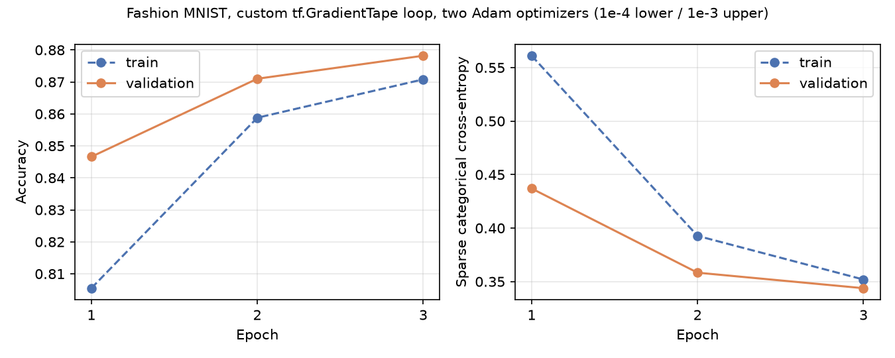

# Fashion MNIST with a custom training loop

A feed-forward network on Fashion MNIST trained without `model.fit()`: a hand-written loop with `tf.GradientTape`, two Adam optimizers at different learning rates for the lower and upper layers, and stateful Keras metrics reset by hand each epoch. Three epochs reach 87.8% validation accuracy. The point of the exercise is the loop, not the score: every step `.fit()` hides (forward pass, loss, gradients, optimizer step, metric bookkeeping) is written out and visible.

[](https://colab.research.google.com/drive/1HJXPNc2vloF3WRn66CvS5lFGj5f6oBA9)



## Problem and data

- **Fashion MNIST** via `keras.datasets`: 60,000 training and 10,000 test images, 28x28 grayscale, 10 clothing classes. Pixels scaled to [0, 1].
- Split: the first 5,000 training images held out for validation, 55,000 for training. Batches of 32, shuffled with a 1,000-image buffer: 1,719 iterations per epoch.

## Approach

1. **Model**: `Flatten → Dense(128, relu) → Dense(128, relu)` ("lower" layers) `→ Dense(64, relu) → Dense(10, softmax)` ("upper" layers).
2. **Two optimizers**: Adam at 1e-4 for the lower layers' variables, Adam at 1e-3 for the upper layers'. The gradient list from one tape is split by variable count and each optimizer applies its slice.
3. **Loss**: `SparseCategoricalCrossentropy` (integer labels, no one-hot).
4. **Metrics**: `keras.metrics.Mean` for loss and `SparseCategoricalAccuracy`, for train and validation, each `reset_state()` at the start of every epoch.
5. **Loop**: for each batch, forward pass inside `tf.GradientTape`, `tape.gradient(loss, variables)`, `apply_gradients` per optimizer, `update_state` on the metrics, a same-line progress print. Validation pass without a tape (`training=False`). 3 epochs.

## Results

| Epoch | Train loss | Train accuracy | Val loss | Val accuracy | Time |
|---|---|---|---|---|---|
| 1 | 0.561 | 80.6% | 0.437 | 84.7% | 114 s |
| 2 | 0.393 | 85.9% | 0.358 | 87.1% | 119 s |
| 3 | 0.352 | 87.1% | 0.344 | 87.8% | 114 s |

Loss is still falling at epoch 3, so the model is under-trained by design (three epochs were chosen to demonstrate the loop). No test-set evaluation was run.

## Concepts (questions set by the professor, with my answers)

- **Custom layer vs custom model.** Subclass `keras.layers.Layer` when you invent one operation or block that does not exist in Keras (a single brick). Subclass `keras.Model` when you assemble bricks into an architecture, or need to control training or saving behaviour (the whole construction).
- **When do you need a dynamic model, and how?** When the architecture depends on the input at run time (Python `if`/`for` inside `call()`), or when you need to step through the network with ordinary `print()` statements. Either write Python control flow in a subclassed `Model.call()`, or compile with `run_eagerly=True`.
- **Why not make every model dynamic?** Eager execution runs line by line in Python. The default graph mode compiles the network into an optimized graph that runs far faster, especially on a GPU. Dynamic mode is for debugging and for the rare architecture that needs it.

## What I learned

- **Trap:** stateful metrics accumulate until reset; without `reset_state()` at the top of each epoch, epoch 2's "average" silently includes epoch 1's batches. **Fix:** reset all four trackers before every epoch. **Takeaway:** `.fit()` does this for you; a custom loop does nothing you did not write.
- **`reset_state`, not `reset_states`.** The method name changed in recent Keras; the old one raises an error. Small, but it costs time when the traceback points into Keras internals.
- **Splitting gradients across optimizers** works by position: one `tape.gradient` call over the concatenated variable list, then slicing the result at `len(lower_layers_weights)`. The order of the variable list is the whole contract.
- **Differential learning rates have a purpose in transfer learning, less so here.** Giving the lower layers a smaller step protects features that are already good. In this network the lower layers start from random weights, so there is nothing to protect yet, and the slower rate most likely just slowed their learning. The technique made full sense one week later, when fine-tuning a pretrained MobileNetV2 ([that repo](https://github.com/StephaneMM/ml-transfer-learning-oxford-pets)).
- **Vocabulary that stuck:** a *batch* is one slice of the data (32 images), an *iteration* is one weight update on one batch, an *epoch* is one full pass (55,000 / 32 = 1,719 iterations). Activation functions: a step function has zero gradient everywhere, which is why it was replaced; sigmoid saturates at the extremes (vanishing gradient), so it stays at the output for probabilities; ReLU keeps a constant gradient for positive inputs and is the default for hidden layers.

## What I'd do next

- Train the same architecture with `model.fit()` for 3 epochs and compare: the custom loop should match it, and the comparison would show whether the split learning rates help or hurt here.
- Evaluate on the 10,000-image test set and report a confusion matrix (shirts vs T-shirts vs pullovers are the known hard cases).
- Run 10 to 15 epochs with early stopping on validation loss; the curves say the model has room left.
- Wrap the loop in `@tf.function` and measure the speedup over the eager version.

## Run it

Open the notebook in Colab (badge above), or locally:

```
pip install -r requirements.txt
jupyter lab notebooks/fashion_mnist_custom_training_loop.ipynb
```

Fashion MNIST downloads automatically through `keras.datasets`.

## Context

Week 5 homework for AIT 506 (Machine Learning), Westcliff University, summer 2026.
